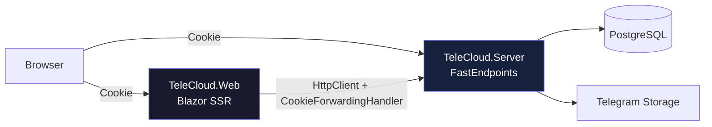
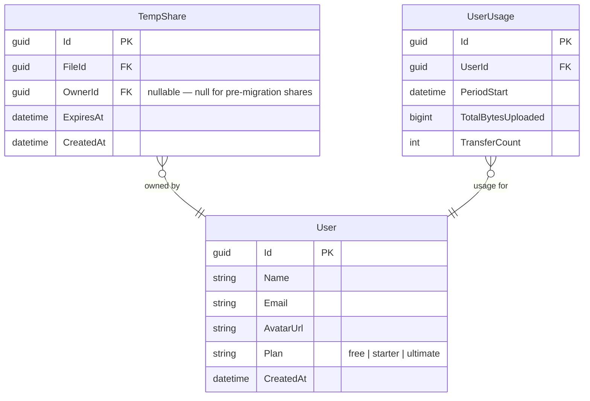

# Architecture Spine — TeleCloud Auth Enforcement

## Design Paradigm

**Blazor Static SSR + FastEndpoints API with Cookie Auth, mediated by Google OAuth.**

Continue the existing two-process architecture:
- **TeleCloud.Web** — Blazor Static SSR frontend. Owns the OAuth challenge flow (`/login/{provider}`), cookie sign-out (`/logout`), and serves all pages. Auth is pre-rendered on the server — no client-side tokens, no JS interop for auth state.
- **TeleCloud.Server** — FastEndpoints API + Wolverine command bus. All write operations and authenticated reads go through here. The API validates the same `.AspNetCore.TeleCloud` cookie that the Web process sets, via a shared Data Protection keyring.

The auth boundary is **server-side cookie validation** — no JWT, no bearer tokens, no client-side session state. The two processes share keys through a filesystem directory (`DataProtection:KeyPath`), so a cookie issued by the Web process is trusted by the API process without a central auth service.



## Invariants & Rules

### AD-1 — Auth enforcement boundary (API)

- **Binds:** CAP-5
- **Prevents:** Endpoints silently accepting unauthenticated requests; relying on UI hiding as the sole auth mechanism.
- **Rule:** Every FastEndpoints endpoint **must** call either `AllowAnonymous()` or `RequireAuthorization()`. The default (`RequireAuthorization()`) is applied by convention — `AllowAnonymous()` must be explicitly justified. Protected endpoints that currently call `AllowAnonymous()` must have it removed:
  - `POST /api/temp` (CreateTempShare) — remove `AllowAnonymous()`, add `RequireAuthorization()`
  - `GET /api/files/{id}/download` — remove `AllowAnonymous()`, add `RequireAuthorization()`
  - All `Files/*` and `Folders/*` endpoints already resolve `CurrentUserService.GetUserIdAsync()` — they must add `RequireAuthorization()` (currently missing)
  - Endpoints that **stay** `AllowAnonymous()`:
    - `GET /api/temp/{id}` — public metadata for the download page
    - `GET /api/temp/{id}/download` — public file download for share recipients

### AD-2 — Auth enforcement boundary (Web SSR)

- **Binds:** CAP-1, CAP-7
- **Prevents:** Anonymous users accessing authenticated Blazor pages; ad-hoc per-page auth checks.
- **Rule:** Add an **auth middleware** in `Program.cs` (before `UseAntiforgery` / `MapRazorComponents`) that intercepts requests to Blazor page routes and redirects unauthenticated visitors to `/login?returnUrl={current}`. Public allowlist:
  - `/login` — login page + OAuth challenge routes
  - `/pricing` — marketing page
  - `/t/{ShareId}` — public download page (renders via Static SSR)
  - `/antiforgery` — antiforgery token endpoint
  - Static assets under `/css/`, `/js/`, `/lib/`
  - The `/logout` endpoint (it signs out and redirects)

### AD-3 — TempShare ownership attribution

- **Binds:** CAP-4
- **Prevents:** Temp shares without an owner; inability to enforce per-user quotas on temp shares.
- **Rule:** Add `Guid? OwnerId` to the `TempShare` entity. In `CreateTempShareHandler`, inject `CurrentUserService` and populate `OwnerId` from `GetUserIdAsync()`. Create an EF migration. Existing shares retain `null` (see AD-8).



### AD-4 — Per-user rate limits

- **Binds:** CAP-6
- **Prevents:** Users bypassing plan-tier limits; unbounded anonymous uploads.
- **Rule:** Introduce a `UserUsage` entity (table `user_usage`) that stores one row per user per billing period. Before creating a temp share, `CreateTempShareHandler` checks:
  1. Lookup or create a `UserUsage` row for the current user where `PeriodStart` falls within the current calendar month (or a user-specific billing cycle).
  2. Sum `TotalBytesUploaded` + new file size and `TransferCount` + 1.
  3. Compare against the user's plan tier limits:
     - `free`: 3 GB / month, 10 transfers / month
     - `starter`: 300 GB / month, 10 transfers / month
     - `ultimate`: unlimited
  4. If exceeded, return 403 (or 429) with a descriptive error message.
  5. If OK, increment the usage row atomically alongside the share creation (within the same Wolverine transaction / EF SaveChanges).

Usage tracking for the `Files/*` endpoints (non-temp file management) is **deferred** — those endpoints already require auth and attribute to `OwnerId`, but their rate limits are not yet defined.

### AD-5 — Plan tier assignment

- **Binds:** CAP-6
- **Prevents:** All users being treated as the same tier; no mechanism for paid plans.
- **Rule:** Add a `Plan` string field to the `User` entity (default `"free"`). When `CurrentUserService.GetOrCreateUserAsync()` creates a new user, set `Plan = "free"`. The field is a DB column that future payment integration can update. Plan limits are defined in a single static `PlanTier` lookup class, not scattered across handlers.

### AD-6 — Public download link invariants

- **Binds:** CAP-3
- **Prevents:** Recipients being forced to authenticate; breaking existing shared links.
- **Rule:** The download flow (`/t/{ShareId}` page + `GET /api/temp/{id}` + `GET /api/temp/{id}/download`) must work **without any auth cookie**. The page route is in the Web SSR allowlist (AD-2); both API endpoints stay `AllowAnonymous()` (AD-1). The page calls `GET /api/temp/{id}` directly from the browser — no `CookieForwardingHandler`, no auth header.

### AD-7 — Cookie auth configuration

- **Binds:** AD-1, AD-2
- **Prevents:** Cookie auth redirecting API calls to HTML login pages; misconfigured cookie behavior.
- **Rule:** Existing `ApiCookieAuthExtensions` already sets `OnRedirectToLogin` → 401 and `OnRedirectToAccessDenied` → 403. This is correct and must stay. The Web's cookie config already sets `LoginPath = "/login"`, `LogoutPath = "/logout"`, `ExpireTimeSpan = 30 days`, `SlidingExpiration = true`. No changes needed.

### AD-8 — Legacy anonymous shares

- **Binds:** CAP-3, CAP-4
- **Prevents:** Breaking existing shared links; requiring retroactive attribution.
- **Rule:** Pre-existing `TempShare` rows with `OwnerId = null` are left as-is. Rate limits don't apply retroactively. The `OwnerId` column is nullable; queries and responses handle null gracefully.

## Consistency Conventions

| Concern | Convention |
| --- | --- |
| Auth check ordering | Server: `RequireAuthorization()` on endpoint configure → `CurrentUserService` in handler. Web: middleware redirect → page renders with `HttpContext.User` available. |
| Auth failure response | HTML: 302 redirect to `/login`. API: 401 with no body (handled by cookie auth redirect suppression). Rate-limit: 403 (quota exceeded) with JSON error body. |
| Plan limit definitions | Single static class `PlanTierLimits` with `GetLimits(plan)` returning `(long? maxBytesPerMonth, int? maxTransfersPerMonth)`. Null = unlimited. |
| Usage rollover | `UserUsage.PeriodStart` resets when the current date passes `PeriodStart + 1 month`. Checked at usage lookup time — no background job needed. |

## Stack

| Name | Version |
| --- | --- |
| Blazor Static SSR | .NET 10 |
| FastEndpoints | (as resolved by project) |
| Wolverine | (as resolved by project) |
| Npgsql + Entity Framework Core | (as resolved by project) |
| Google OAuth | ASP.NET Core built-in |
| Cookie Authentication | ASP.NET Core built-in |

## Structural Seed

```
src/
  TeleCloud.Web/
    Program.cs                          # + auth middleware, public allowlist
    App.razor                           # unchanged
    Routes.razor                        # unchanged
    Pages/
      Upload.razor                      # copy update: remove "no login required"
      Download.razor                    # copy update: remove "No login required"
      Login.razor                       # unchanged
      Account.razor                     # already implicitly auth-gated
      Pricing.razor                     # unchanged (public)
  TeleCloud.Server/
    Program.cs                          # unchanged (auth wire-up already done)
    Infrastructure/
      ApiCookieAuthExtensions.cs        # unchanged
    Features/
      Auth/
        CurrentUserService.cs           # unchanged (already resolves user)
      TempShares/
        Create/
          CreateTempShareEndpoint.cs    # remove AllowAnonymous()
          CreateTempShareHandler.cs     # + CurrentUserService, + plan limit check
        Shared/
          TempSharePolicy.cs            # unchanged
          TempSharePolicy.cs            # + rate limit helpers (or new file)
          TempShareResponse.cs          # unchanged
          TempShareMapper.cs            # unchanged
      Files/
        Download/
          DownloadFileEndpoint.cs       # remove AllowAnonymous()
    Data/
      TempShare.cs                      # + OwnerId
      User.cs                           # + Plan
      UserUsage.cs                      # NEW entity
      TeleCloudDbContext.cs             # + DbSet<UserUsage>, + TempShare.OwnerId config
```

## Capability → Architecture Map

| Capability | Lives in | Governed by |
| --- | --- | --- |
| CAP-1 — Auth gate for protected pages | `TeleCloud.Web/Program.cs` auth middleware | AD-2 |
| CAP-2 — Upload requires login | `CreateTempShareEndpoint.cs` + auth middleware in Web | AD-1, AD-2 |
| CAP-3 — Public download links | `GetTempShareEndpoint.cs`, `DownloadTempShareEndpoint.cs`, Download.razor | AD-6 |
| CAP-4 — Upload attribution | `TempShare.cs` entity + `CreateTempShareHandler` + `CurrentUserService` | AD-3 |
| CAP-5 — Server-side auth enforcement | All endpoint `Configure()` methods | AD-1, AD-7 |
| CAP-6 — Per-user rate limits | `UserUsage.cs`, `PlanTierLimits`, `CreateTempShareHandler` | AD-4, AD-5 |
| CAP-7 — Public pages stay public | Auth middleware allowlist in `Program.cs` | AD-2 |

## Deferred

| Decision | Why deferred |
| --- | --- |
| Rate limits for `Files/*` and `Folders/*` endpoints | Those endpoints already require auth and attribute to `OwnerId`, but specific quota values (GB limit, transfer count) aren't defined yet. The architecture supports it later by reusing the same `UserUsage` entity. |
| Payment / plan upgrade flow | Out of scope (non-goal). The `Plan` field on `User` is an enum column ready for a future Stripe/Paddle integration to write to. |
| Admin panel for managing users/plans | Explicit non-goal in the spec. |
| Social login providers beyond Google | Non-goal. GitHub/Facebook/TikTok provider configs are wired in the `.AddAuthentication().AddGoogle()` chain but their button links exist — unregister them or leave as dead buttons (deferred decision). |
| User registration beyond OAuth | Non-goal. No email/password flow. |
| WebAuthn / MFA | Non-goal. |
| Usage tracking for non-temp operations | File management (Files/Folders) already auth-gated and attributed; rate limits for those API areas are a future concern. |
