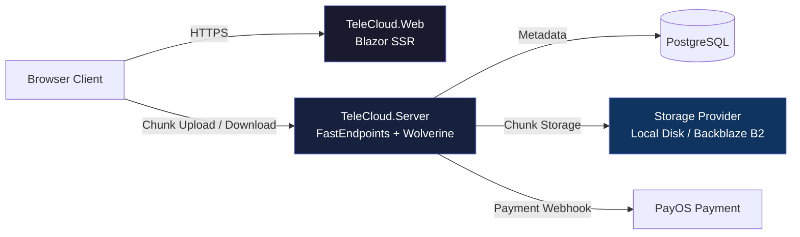

# Architecture Spine — TeleCloud Owned Storage System

## Design Paradigm

**Blazor Static SSR + FastEndpoints + Wolverine vertical slice architecture with configuration-based storage provider abstraction.**

Continue the existing two-process architecture with storage backend replacement:
- **TeleCloud.Web** — Blazor Static SSR frontend (unchanged)
- **TeleCloud.Server** — FastEndpoints API + Wolverine command bus (storage backend replaced)
- **PostgreSQL** — Metadata, Delivery entities, Manifests (unchanged)
- **Owned Storage** — Local disk primary + Backblaze B2 cold overflow (replaces Telegram)

The storage layer is abstracted behind `IStorageProvider` interface, enabling provider switching via configuration without API layer changes. Chunked uploads use idempotent parallel chunk operations with atomic commit, enabling resume capability and preventing partial delivery corruption.



## Invariants & Rules

### AD-1 — Storage Provider Abstraction

- **Binds:** FR-1, FR-3
- **Prevents:** Storage backend leakage into API handlers; provider lock-in; migration complexity
- **Rule:** All storage operations go through `IStorageProvider` interface. No direct file system access in handlers. Provider selection via configuration only (single active provider at runtime). Local disk primary, Backblaze B2 cold overflow. Handler code references `IStorageProvider`, never concrete implementations.

```csharp
interface IStorageProvider {
    Task<string> StoreChunkAsync(chunkId, byte[] data, CancellationToken ct);
    Task<byte[]> GetChunkAsync(string chunkId, CancellationToken ct);
    Task DeleteChunksAsync(string[] chunkIds, CancellationToken ct);
}
```

### AD-2 — Chunked Upload Flow Architecture

- **Binds:** FR-1, FR-2, FR-3
- **Prevents:** Partial delivery corruption; upload resume failures; inconsistent chunk state
- **Rule:** Chunked uploads follow three-phase pattern: (1) `POST /api/uploads/start` creates `UploadSession` with unique `uploadId`, (2) `POST /api/uploads/{uploadId}/chunks/{chunkIndex}` uploads chunks idempotently in parallel, (3) `POST /api/uploads/{uploadId}/commit` atomically creates `Delivery` entity. Chunks auto-commit individually; only final commit operation runs atomically. Chunk uploads ordered by index but can arrive out-of-order; commit validates all required chunks present.

### AD-3 — UploadSession Resume State

- **Binds:** FR-2
- **Prevents:** Resume failure; orphaned storage accumulation; upload session inconsistency
- **Rule:** `UploadSession` entity tracks upload state with 24-hour TTL. Background cleanup job runs daily to delete expired sessions and orphaned chunks. Client queries upload state via `GET /api/uploads/{uploadId}/status` to determine missing chunks for resume. Session state scoped per user; cross-device resume supported via server-side tracking.

### AD-4 — Idempotent Chunk Operations

- **Binds:** FR-2
- **Prevents:** Duplicate storage on retry; bandwidth waste; resume logic complexity
- **Rule:** Chunk uploads are idempotent via skip-if-exists logic. Server checks chunk existence by `uploadId + chunkIndex` before storage; returns existing `chunkId` if present. Client can safely retry chunk uploads without duplicate storage. No client-side deduplication state required.

### AD-5 — Transaction Model Boundaries

- **Binds:** FR-2, FR-3
- **Prevents:** Transaction scope confusion; inconsistent chunk state; commit failures
- **Rule:** Chunk uploads execute in individual Wolverine transactions (auto-commit). Only the final commit operation runs in a transactional atomic block that creates the `Delivery` entity, `Manifest` record, and links uploaded chunks. Failed commit rolls back Delivery creation but chunks remain available for retry. No multi-hour transaction spans chunk upload phase.

### AD-6 — Entity Relationship Model

- **Binds:** FR-1, FR-15
- **Prevents:** Referential integrity violations; orphaned entities; migration confusion
- **Rule:** Core entity relationships: `Delivery (1) → Manifest (1) → Chunks (many)`. `UploadSession (1) → Chunks (many)` for in-progress uploads. `Delivery` owned by `User` (many-to-one). `DownloadTracking (many) → Delivery (one-to-many)` for IP-based download accounting. All relationships enforce referential integrity via foreign key constraints with `ON DELETE CASCADE` for child cleanup.

### AD-7 — Manifest Storage Location

- **Binds:** FR-1, FR-3
- **Prevents:** Metadata fetch overhead; transaction complexity; storage provider coupling
- **Rule:** Encrypted `Manifest` stored as `bytea` column in PostgreSQL `manifests` table, co-located with `Delivery` metadata. Enables ACID-compliant queries, JOIN operations, and transactional consistency without separate storage fetch overhead. Chunk storage references (paths/keys) embedded in manifest; actual chunk data stored via `IStorageProvider`.

### AD-8 — Data Model Migration Strategy

- **Binds:** System migration from Telegram backend
- **Prevents:** Legacy schema contamination; hybrid entity confusion; unclear migration path
- **Rule:** Clean break migration—new `Delivery`, `Manifest`, `Chunk` entities created via EF Core migration. Legacy `File`, `TempShare` tables deprecated and retained for migration only. One-time migration script transforms existing Telegram-based data to new schema. No parallel operation of old and new systems. Migration executed before owned storage deployment; WTelegramClient session data not preserved.

### AD-9 — API Endpoint Structure

- **Binds:** API consistency, upload session separation
- **Prevents:** Endpoint naming collisions; upload/delivery confusion; public endpoint misconfiguration
- **Rule:** Separate endpoint prefixes by concern: `/api/uploads/*` for chunked upload operations (`start`, chunk upload, `commit`, `status`), `/api/deliveries/*` for Delivery CRUD operations, `/d/{shareId}` for public recipient downloads (no authentication required). Existing `/api/files/*` and `/api/folders/*` endpoints remain unchanged for backward compatibility during migration.

### AD-10 — Download Abuse Protection

- **Binds:** FR-18, FR-19
- **Prevents:** Abuse detection evasion; download tracking bypass; rate limit circumvention
- **Rule:** Recipient downloads tracked via IP logging and rate limiting per FR-18. Server records download metadata (IP address, timestamp, `shareId`) without content access. Download endpoints enforce rate limits via IP-based throttling. Report button (FR-19) creates abuse reports stored for moderation. No recipient authentication required but IP-based tracking enables abuse detection while maintaining recipient-no-auth principle.

### AD-11 — Payment Integration Architecture

- **Binds:** FR-13
- **Prevents:** Payment polling overhead; webhook forgery; delivery unlock inconsistency
- **Rule:** PayOS webhook-based payment verification. Public webhook endpoint `/api/payments/payos/webhook` receives payment notifications, verifies HMAC-SHA256 signature via SDK, unlocks `Delivery` atomically via transactional update. Payment status stored on `Delivery` entity; unlock triggered by webhook only—no client-side polling. HMAC signature verification prevents spoofed payment notifications.

### AD-12 — Error Handling and Validation

- **Binds:** System reliability, user experience consistency
- **Prevents:** Silent failures; inconsistent error responses; orphaned storage
- **Rule:** LightResults `Result<T>` pattern continues for functional error handling. Chunk upload validation (size limits, quota checks, content type verification) occurs before storage commit. Failed uploads return structured error responses without orphaning chunks. Wolverine transaction rollback prevents partial state corruption on commit failures. Validation failures return 400/403/413 with clear error messages; system errors return 500 with ProblemDetails format.

### AD-13 — Storage Provider Configuration

- **Binds:** AD-1, operational deployment
- **Prevents:** Runtime provider confusion; manual provider switching; configuration drift
- **Rule:** Single active storage provider per environment via configuration. `TeleCloudOptions` specifies `StorageProvider: "LocalDisk"` or `"StorageProvider: "BackblazeB2"`. Provider instantiation via DI with singleton scope. Provider switching requires configuration change and restart, not runtime toggling. Local disk paths, Backblaze B2 credentials, and chunk size defaults all configuration-driven.

### AD-14 — Background Job Architecture

- **Binds:** AD-3, operational maintenance
- **Prevents:** Manual cleanup processes; job scheduling conflicts; resource contention
- **Rule:** Background cleanup job executes daily to delete expired `UploadSession` entities and orphaned chunks. Job implemented via recurring task scheduler (Hangfire or .NET HostedService). Job execution time configurable via configuration. Cleanup runs in transactional batches to prevent database lock contention. Job logs cleanup statistics (sessions deleted, chunks reclaimed, storage freed).

### AD-15 — Client-Side Encryption Architecture

- **Binds:** FR-4, FR-5, FR-6
- **Prevents:** Server access to plaintext; IP vulnerability; encryption inconsistency across platforms
- **Rule:** Encrypt-before-upload with AES-256-GCM per-chunk AEAD. Client (browser WASM) generates encryption key, encrypts entire file, splits ciphertext into chunks, uploads only ciphertext. Key exists only in URL fragment (`#key`), never transmitted to server. Independent per-chunk nonce with AAD binding `manifest_id + chunk_index`. Server handles only ciphertext, zero-knowledge by construction. No server-side decryption capability.

### AD-16 — Download-Count Cap Invariant

- **Binds:** FR-11, FR-18
- **Prevents:** Bandwidth cost spiral; abuse through mass-downloading; economic unsustainability
- **Rule:** `Delivery.MaxDownloads` field enforced at API level before chunk serving. Counter atomically incremented per successful download; cap reached returns 410 locked response without serving chunks. Critical bandwidth cost control—prevents 75 TB served from becoming 150 TB at 2× average downloads. Cap value Plan-bound (Free: 5, Pro: 50, Studio: configurable) with configuration-driven defaults.

### AD-17 — Egress Accounting Architecture

- **Binds:** FR-13
- **Prevents:** Studio tier economic loss; surprise billing; inability to implement passthrough pricing
- **Rule:** `Delivery.EgressBytes` field tracks total bytes served. Studio tier enforces monthly allowance via `User.EgressAllowance`; overage charged per-GB. Atomic counter increment per chunk served; allowance check before chunk delivery. Enables "egress passthrough" pricing model preventing surprise bills like MASV ($275 for 100GB re-downloaded). Egress tracking metadata-only, no content access.

### AD-18 — Ad Injection Architecture

- **Binds:** FR-20, FR-21
- **Prevents:** Dirtying Pro/Studio deliveries; breaking "ad-free handoff" value proposition; inconsistent ad placement
- **Rule:** Recipient page ad rendering based on `User.PlanId` lookup via `Delivery.SenderId`. Free plan → ads injected; Pro/Studio plans → clean recipient page (sold feature). Clean trial allowance (3-5 deliveries) tracked via `User.CleanDeliveriesRemaining`. Ad injection point architecturally invariant at page template level, not handler-level logic. Prevents accidental ad injection into paid deliveries.

### AD-19 — Access Control Architecture

- **Binds:** FR-7, FR-12
- **Prevents:** Authentication requirement for recipients; password-fragment key confusion; access control bypass
- **Rule:** Recipient-never-authenticates via public endpoint `/d/{shareId}#{key}`—no authentication required. Password protection as independent server-side access gate via `Delivery.Password` field; password verification precedes fragment key decryption. Two-factor access: (1) password server-check, (2) fragment key client-decrypt. Open Question 3 resolution: password independent of encryption, not folded into key derivation.

### AD-20 — Zero-Knowledge Verification Architecture

- **Binds:** FR-6
- **Prevents:** unverifiable privacy claims; trust dependencies on proprietary assertions
- **Rule:** "Verify it yourself" capability via standard browser DevTools inspection. Client-side crypto runs in WASM/JS, inherently inspectable via browser debugging tools. Optional in-app network inspector component shows ciphertext-only request bodies and key absence. No proprietary verification required—architecture itself verifiable via standard browser tools. Trust via transparency and inspectability, not black-box claims or proprietary verification services.

### AD-21 — Anti-Adblock Posture

- **Binds:** FR-22
- **Prevents:** False-blocking legitimate users; breaking download functionality; user experience deterioration
- **Rule:** Soft-wall with retry, never hard-block. Adblock detection shows "please allow ads to keep free tier running" message + retry button. Downloads never blocked on adblock detection—prevents false-blocking Brave/Firefox-privacy/DNS-filter users from files they have legitimate right to access. Optional Ad-Shield-style subdomain serving to evade filter lists, but never hard file access blocking. User retention prioritized over ad recovery.

## Deferred

### Concurrency Control
Plan-dependent chunk upload concurrency limits (Free: 1-2, Pro: 3-4, Studio: 6+) deferred to handler-level implementation with configuration-driven defaults. Architecture supports per-Plan concurrency but specific limits not invariant.

### Overflow Architecture
Automatic overflow trigger logic (local disk capacity threshold → Backblaze B2 activation) deferred to operational policy. Storage provider interface supports overflow but specific capacity thresholds and migration triggers not architecturally invariant.

### Ad Network Integration
FR-20/FR-22 ad network integration details (Adsterra/PopAds API integration, impression tracking, adblock detection) deferred to delivery page implementation. Architecture supports ad injection but specific network selection and integration patterns not invariant.

### VietQR / PayOS Integration
PayOS webhook primary payment integration for plan upgrades. PayOS handles bank transfer (VietQR), card, and e-wallet payments. Architecture webhook pattern reusable for per-delivery payments if needed.

### Compression and Optimization
Stream-as-you-go download, client-side compression, and chunk size optimization algorithms deferred to performance tuning phase. Architecture supports chunked transfer but specific compression strategies not invariant.

## Open Questions

1. **Chunk Size Calibration** — 256–512 MB default size tunable via configuration, but optimal size for Vietnamese networks requires production benchmarking.
2. **Concurrent Upload Limits** — Per-Plan concurrency limits (Free: 1-2, Pro: 3-4, Studio: 6+) need load testing validation.
3. **Overflow Trigger Thresholds** — Local disk capacity percentage that triggers Backblaze B2 overflow requires operational definition.
4. **Webhook Security** — PayOS webhook HMAC signature verification mechanism and key management requires documentation.
5. **Background Job Scheduling** — Specific task scheduler implementation (Hangfire vs. HostedService) requires selection.
6. **Clean Trial Tracking** — Clean delivery allowance counting and reset mechanism requires UX flow specification.

## Resolved Questions

1. **Password vs Fragment Key Interaction** — Resolved via AD-19: Password as independent server-side access gate, not folded into key derivation. Two-factor access: password verification (server) + fragment key decryption (client).
