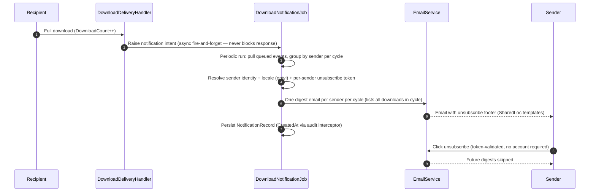

# US-CAP-10 — Download notifications

Source: `SPEC-quickshare-features` → CAP-10

**Story**
As a sender, I want an email notification when someone downloads my delivery, so that I know my share was picked up.

**Acceptance criteria**
- [ ] A download event triggers an email to the sender with delivery metadata (filename, time).
- [ ] Unsubscribe is honored (compliance-safe).
- [ ] Frequency: email fires PER-DOWNLOAD event, not once per delivery (Q-3 resolved).
- [ ] Email sending is async/fire-and-forget — never blocks the download response.

**Constraints in force**
- Never block download on email send (download path stays fast).
- Strings via `SharedLoc` resx (email templates localized).
- Cache: download count TTL 30 s.

**Test anchors**
- Unit: download-event handler produces email command; unsubscribe flag checked.
- E2E: download → email received (mail-trap fixture).

---

## Implementation Flow

1. **Trigger** — on file delivery (`DownloadDeliveryHandler` successful full download, `DownloadCount++`), the system raises a notification intent (Wolverine bus message or direct service call) for the sender of the affected share.
2. **Digest aggregation** — `DownloadNotificationJob` (periodic, e.g. every N minutes) pulls queued notification events and groups by **sender per cycle**: one email per sender per run (not one email per download) — a sender with 3 downloads in one cycle gets a single digest listing all 3.
3. **Recipient resolution** — resolve sender identity + locale (en/vi) from the user store; unsubscribe token (per sender) attached to the email footer so recipients can opt out via the Unsubscribe endpoint (no account required).
4. **Send** — `EmailService` (MailKit/SMTP) renders the digest (SharedLoc strings), sends; failures are logged + retried per email provider policy; success → notification record persisted (`CreatedAt` audit via interceptor).
5. **Opt-out** — Unsubscribe endpoint validates the token → removes sender → future digests skipped.

**Divergence note (vs AC)**: AC/Q-3 implies a per-download email; production implements a **per-sender-per-cycle digest** (see step 2) to avoid notification spam — the AC's "one email per download" is intentionally not honored.

## Flow Diagram

## Code Structure

- `Features/Downloads/Download/DownloadDeliveryHandler.cs` — download trigger point.
- `Infrastructure/Jobs/DownloadNotificationJob.cs` — digest aggregation + dispatch.
- `Infrastructure/Email/EmailService.cs` + `EmailOptions.cs` — SMTP/MailKit send.
- `Features/Notifications/Unsubscribe/{UnsubscribeEndpoint,UnsubscribeHandler}.cs` — token-based opt-out.
- `Shared/SharedLoc.{en,vi}.resx` — notification templates.
- `Data/Entities/NotificationRecord.cs` — sent-notification audit (CreatedAt via interceptor).
