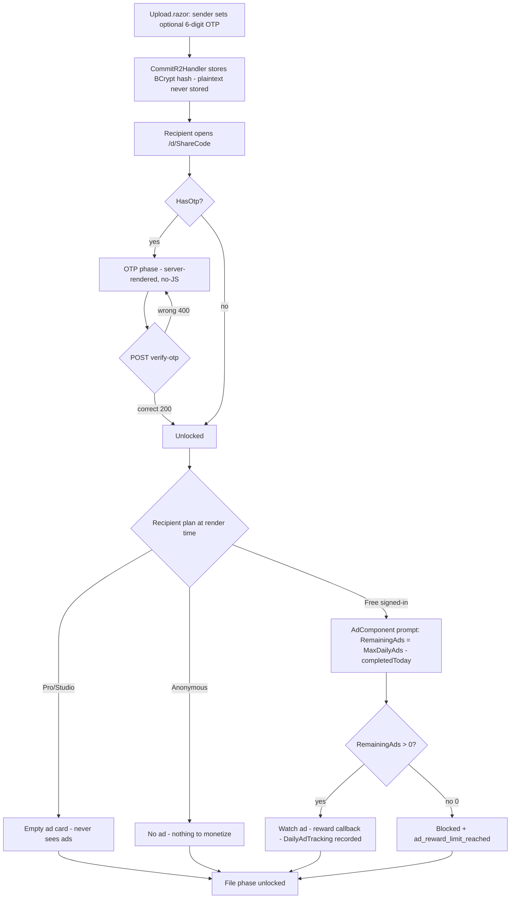

# US-CAP-4 — Download gates (OTP / password / ad)

Source: `SPEC-quickshare-features` → CAP-4

**Story**
As a sender, I want to protect a delivery with a 6-digit OTP and/or a password, and as a free-plan user I may watch a short ad before download, so that only intended recipients can access the file while the product still monetizes free deliveries.

**Acceptance criteria**
- [ ] Sender can set a 6-digit OTP, a password, or both — per delivery.
- [ ] Unverified attempts are blocked; correct OTP/password passes.
- [ ] Free-plan deliveries may show an ad interstitial before download, at most once per delivery; reward recorded.
- [ ] Pro/Studio recipients never see ads (plan-gated at render time).
- [ ] Gates are sender-controlled per delivery.
- [ ] Failed gate attempts degrade gracefully (clear error, no exception leak).

**Constraints in force**
- No-JS download default phase must stay usable (gates must degrade without JS).
- Plan gating at render time — free only sees ads.
- Ad tracking cache TTL 1 min; ad reward definition per Open Question Q-4 (confirm before implementing reward path).
- Strings via `SharedLoc.{en,vi}.resx`.

**Test anchors**
- Unit: gate logic — blocked/passed for OTP, password, both.
- E2E: free-plan download shows ≤1 interstitial; Pro download shows none.
- Browser: no-JS recipient still sees the gate prompt phase.

---

## Implementation Flow

1. **Sender-side gate setup** — Upload.razor: optional 6-digit OTP (hidden until input, digits 0-9, cleared on wrong verify); optional expiry 7d. OTP (if set) passes through `/api/uploads/commit-r2` → `CommitR2Handler` stores `OtpHash = BCrypt.HashString(otp)` on Delivery (server never stores the plaintext).
2. **Recipient OTP gate** — Download.razor: `HasOtp` → `InitialPhase = "otp"` (server-rendered, no-JS friendly). `download.js` POSTs `/api/deliveries/{ShareCode}/verify-otp` → `VerifyOtpHandler` bcrypt-verifies → 200 OK / 400 "incorrect-otp". Verified state unlocks the ad/file phase; `verifiedOtp` also flips the no-JS download anchor into native-navigation mode.
3. **Ad gate (Free tier only, plan-gated at render time)** — `AdComponent.razor` (download page + upload page + P2P):
   - Anonymous user → renders nothing (no plan to monetize).
   - No `ad-consent=granted` cookie → upgrade CTA card (`ad_no_consent_*` Loc keys).
   - Shell render (no `HX-Request`) → skeleton `hx-get="@AdConstants.RewardPromptRoute"` `hx-trigger="load"` `hx-target="#ad-reward-card"` `hx-swap="outerHTML"`.
   - HTMX response → resolve plan via cache: **Pro/Studio → empty `

`** (never see ads); **Free → full prompt** (title, remaining count, watch button; disabled + `ad_reward_limit_reached` when 0; dev simulate only when `Ads:DevSimulation=true`).
   - `RemainingAds` = `MaxDailyAds - completedToday` from cache `ads:daily:{userId}:{date}` (TTL 1 min).
4. **Reward callback** — `QuickShareAds.init({ adUnitId: 'ca-app-pub-3940256099942544/5224354917', callbackUrl, antiForgeryToken, remainingAds })` → watch ad → rewarded → POST callback `{token, rewardAmount}` + `RequestVerificationToken` header → `RewardCallbackHandler` validates, records `DailyAdTracking`, dispatches CustomEvent `quickshare:ad-rewarded` (P2P uses this to unlock + refetch quota).
5. **Divergence notes (vs AC)**: password gate in AC is **not implemented** — only 6-digit OTP exists (see CAP-2 divergence for encryption instead of obfuscation); "at most once per delivery" is enforced as a **daily per-user cap** (`ads:daily:{userId}:{date}`), not per-delivery.

## Flow Diagram

## Code Structure

- `Features/Deliveries/Otp/{VerifyOtpEndpoint,VerifyOtpHandler}.cs` — OTP verify.
- `Infrastructure/Constants/AdConstants.cs` — reward routes + MaxDailyAds + dev flag.
- `Features/Ads/RewardCallback/{RewardCallbackEndpoint,RewardCallbackHandler}.cs` — reward validation.
- `Features/Ads/CookieConsent/CookieConsentEndpoint.cs` + `Components/Shared/CookieConsent.razor` — consent gating.
- `Components/Shared/AdComponent.razor` + `Components/Pages/AdReward.razor` + `wwwroot/js/ad-component.js`.
- `Data/Entities/DailyAdTracking.cs`.
