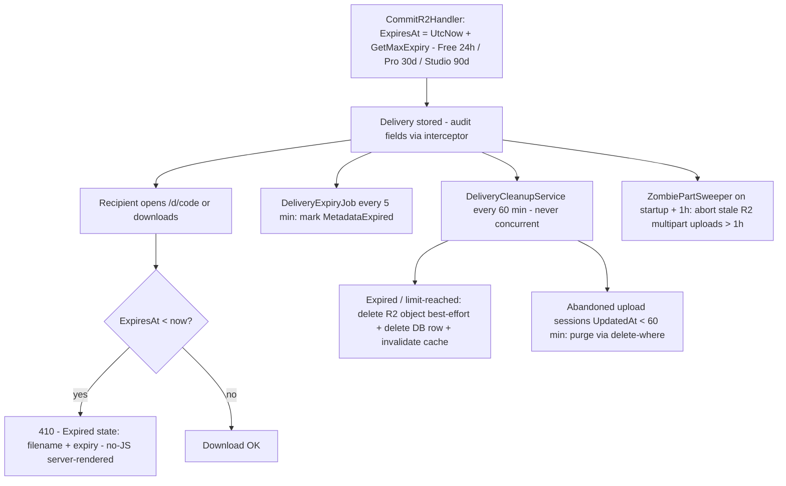

# US-CAP-5 — Expiry and auto-cleanup

Source: `SPEC-quickshare-features` → CAP-5

**Story**
As a sender, I want my deliveries to expire automatically (24 h or 7 d by plan) and be cleaned up, so that my data doesn't linger on the server forever.

**Acceptance criteria**
- [ ] Deliveries carry a server-enforced expiry timestamp; expiry is enforced server-side, not client-side.
- [ ] Expiry duration follows plan: 24 h (free) / 7 d (Pro/Studio) — from a single limits source.
- [ ] Accessing an expired link renders a clear expiration message (filename + expiry time), never a broken page.
- [ ] Background cleanup job removes expired objects from storage and DB.
- [ ] Cleanup and expiry checks use audit fields only via `AuditableEntityInterceptor` — never manual `CreatedAt`/`UpdatedAt`.

**Constraints in force**
- Server-enforced access cutoff (backend, not client).
- Expired-link UX: clean state, no 404/exception.
- Cache invalidation after cleanup mutations.

**Test anchors**
- Unit: expiry predicate + cleanup job targeting.
- E2E: link past expiry shows expiration state; job removes object from R2 + DB.

---

## Implementation Flow

1. **Expiry set at commit** — `CommitR2Handler`: `ExpiresAt = UtcNow + GetMaxExpiry(plan)` (fixed per plan — Free/Anonymous 24h, Pro 30d, Studio 90d; no user choice; overridable by admin via `Pricing:Limits` config). `AuditableEntityInterceptor` auto-fills `CreatedAt`/`UpdatedAt` (never set manually).
2. **Soft expiry (reads + range/streams)** — `DownloadDeliveryHandler`: `ExpiresAt < UtcNow` → **410** (Info handler returns `DeliveryExpired` → same code). `DownloadInfoHandler.GetAsync`: expired → `DeliveryExpiredException`. Client renders Expired state with filename + expiry; no broken stream.
3. **Journal expiry sweep** — `DeliveryExpiryJob` (singleton hosted service, runs every **5 minutes**): marks Journal/Manifest deliveries `MetadataExpired = true` when `ExpiresAt <= Now`.
4. **Hard cleanup** — `DeliveryCleanupService` (singleton, interval `QuickShareOptions.CleanupIntervalMinutes`, default **60** min):
   - Expired and/or chunk-limit-reached deliveries → delete R2 objects (best-effort per entry; a missing object is not fatal) → delete DB rows.
   - Abandoned uploads: **all** in-progress upload sessions with `UpdatedAt < cutoff` (60 min) deleted unconditionally via delete-where.
   - Fires `delivery-expired` cache invalidation events; guard: task never restarts concurrently (fails fast if already running).
5. **Multipart tail cleanup** — `ZombiePartSweeper` (on startup + 1h interval): lists in-progress R2 multipart uploads, aborts ones stale > 1h; timeout is not treated as error (best-effort).
6. **Client-facing flow** — share link past expiry → download /d/{code} → 410 → Expired phase (no JS needed for that state — server-rendered). Expired share never appears in history (`AccountHandler` filters expired out of the folder listing).

## Flow Diagram

## Code Structure

- `Infrastructure/Jobs/DeliveryExpiryJob.cs` — 5-min expiry flag sweep.
- `Infrastructure/Jobs/DeliveryCleanupService.cs` — R2 object + row deletion, abandoned-session purge.
- `Infrastructure/Jobs/ZombiePartSweeper.cs` — stale multipart abort.
- `Features/Downloads/Download/DownloadDeliveryHandler.cs` — 410 on expired.
- `Features/Downloads/Info/DownloadInfoHandler.cs` — `DeliveryExpired` mapping.
- `Features/Uploads/CommitR2/CommitR2Handler.cs` — `ExpiresAt` assignment.
- `Infrastructure/Config/QuickShareOptions.cs` — `CleanupIntervalMinutes` (default 60).
- `Infrastructure/Interceptor/AuditableEntityInterceptor.cs` — audit timestamps.
