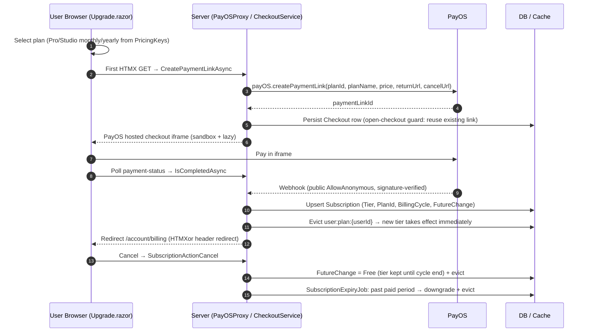

# US-CAP-8 — Payments and subscriptions

Source: `SPEC-quickshare-features` → CAP-8

**Story**
As a sender, I want to upgrade my plan by paying through PayOS (VietQR, card, e-wallet) and have my subscription lifecycle managed automatically, so that I get higher limits without manual intervention.

**Acceptance criteria**
- [ ] Payment intent → PayOS checkout → webhook → plan upgraded.
- [ ] Payment callback/webhook endpoints are public: `AllowAnonymous()` explicit (never manual `IsAuthenticated` gate).
- [ ] Subscription lifecycle holds: renew, cancel, expire — expiry/cancel downgrades the plan.
- [ ] Payment status and receipts visible in billing UI.
- [ ] Payment events follow the documented schema (see sibling `spec-payment/payment-events-schema.md`).
- [ ] Plan-change mutations invalidate plan/user cache keys.

**Constraints in force**
- PayOS is the only payment provider (decision).
- Webhook + payment callback: `AllowAnonymous()`.
- User/billing cache TTL 2–5 min; invalidation on subscription mutation.
- Entity→DTO via Mapperly (or LINQ projection exception).

**Test anchors**
- Unit: webhook signature/state transition — paid → upgraded; expired → downgraded.
- E2E: PayOS sandbox checkout → plan change reflected in profile.

---

## Implementation Flow

1. **Upgrade entry** — `Upgrade.razor` (`/upgrade`): dropdown selects plan (Pro monthly 9 / Pro yearly 77 / Studio monthly 29 / Studio yearly 239, from config `PricingKeys`), "Upgrade" → server call.
2. **Checkout create (auto)** — `CreatePaymentLinkAsync` runs server-side on the first HTMX GET (no manual post): `PayOSProxy` → `payOS.createPaymentLink({ planId, planName, price, returnUrl, cancelUrl })` → `Checkout` row persisted (`UserId`, `PaymentLinkId`, `Status`);
   - `FindAllPageAsync` guard: if an open Checkout already exists → return the existing link instead of duplicating.
   - Frontend then injects the **PayOS hosted checkout iframe** (`sandbox="allow-scripts allow-same-origin allow-forms allow-popups"`, `loading="lazy"`) pointing at the payment link.
3. **Poll completion** — `payment-status` target polls `Checkout.IsCompletedAsync(paymentLinkId, ct)` on an interval (HTMX `hx-trigger` on load + delay); when complete → `HtmxHeaders.Redirect("/account/billing")` (HTMXor header-based redirect, no JS needed).
4. **Webhook confirmation (authoritative)** — PayOS POSTs back to webhook endpoint (public, signature-verified): handler upserts the `Subscription` row (`Tier`, `PlanId`, `BillingCycle`, `FutureChange`), notifies the upgrade, and calls `UserCacheInvalidator.EvictAsync` → `user:plan:{userId}` (10-min cache) purged so the new tier takes effect immediately.
5. **Billing history** — `/account/billing` (AccountBilling page): `BillingHistoryService.GetForUserAsync(userId, ct)` lists past payments + `SubscriptionService.GetCurrentAsync` current plan; cancel flow posts `SubscriptionActionCancel` = `"cancel"` → `SubscriptionService.CancelAsync` (graceful: keeps tier until cycle end, `FutureChange = Free`), then `UserCacheInvalidator.EvictAsync`.
6. **Expiry of benefits** — `SubscriptionExpiryJob` (periodic) sweeps subscriptions past their paid period → downgrades tier → evicts user cache.

## Flow Diagram

## Code Structure

- `Pages/Upgrade.razor` + `wwwroot/js/upgrade.js` — plan picker + PayOS iframe + polling.
- `Features/Payments/PayOSProxy.cs` — PayOS API wrapper + signature verification.
- `Features/Payments/SendBillingTelemetry` — analytics hook.
- `Features/Payments/Checkout/{Checkout,IsCompleted?}` + `CheckoutService` — payment-link lifecycle.
- `Features/Payments/Subscriptions/SubscriptionService.cs` + `SubscriptionExpiryJob.cs` — plan state + expiry sweep.
- `Features/Payments/BillingHistory/BillingHistoryService.cs` — history query.
- `Infrastructure/Constants/PricingKeys.cs` + `PlanLimitsConfig.cs` — prices/plan config.
- `Infrastructure/Caching/UserCacheInvalidator.cs` — cache eviction after upgrade/webhook/cancel.
