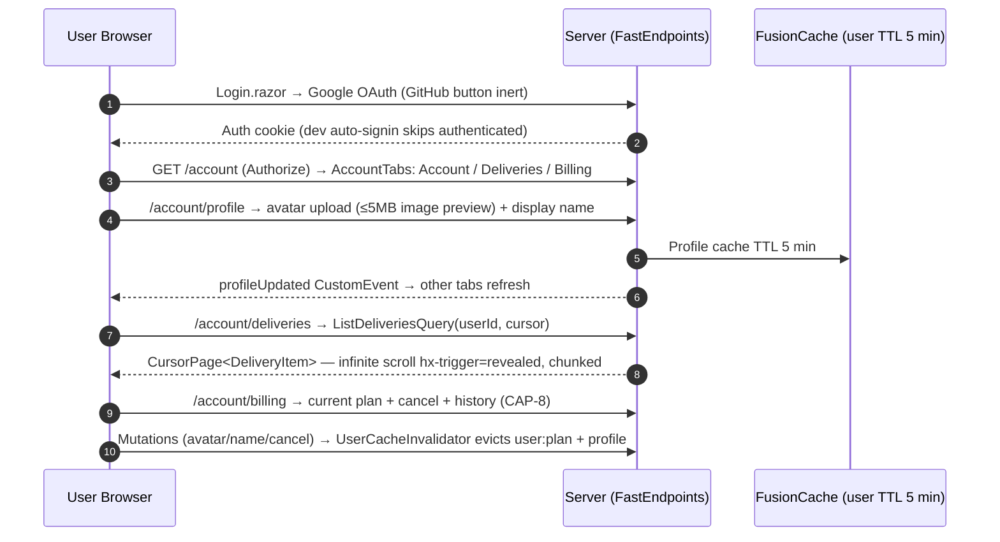

# US-CAP-9 — Account and profile

Source: `SPEC-quickshare-features` → CAP-9

**Story**
As a sender, I want to sign in with my Google account and manage my profile, delivery history, and billing, so that my shares and plan are tied to me across sessions.

**Acceptance criteria**
- [ ] Sign in with Google OAuth (functional). GitHub button renders but is present-but-inert — no wired OAuth client (Q-1 resolved).
- [ ] User can edit name and avatar.
- [ ] User sees past deliveries (delivery history).
- [ ] User sees billing state (plan, payment status, receipts).
- [ ] FastEndpoints enforces auth by default; only intended endpoints use `AllowAnonymous()`.
- [ ] Profile/billing data cached with 2–5 min TTL; invalidated on mutation.

**Constraints in force**
- Auth boundary = FastEndpoints (no manual `IsAuthenticated` gates).
- Audit fields via interceptor only.
- User-facing strings via `SharedLoc` resx; isolation CSS per component; HTMX partials styled via prefixed global classes (`account-`).

**Test anchors**
- Unit: profile update handler + cache invalidation.
- E2E: Google sign-in → edit name/avatar → history + billing render.

---

## Implementation Flow

1. **Auth shell** — `Login.razor` (Google external sign-in; GitHub button inert) → cookie-based auth (dev auto-signin middleware in `Program.cs` skips already-authenticated requests; `[Authorize]` on account endpoints).
2. **Tabs shell** — `/account` → `Account.razor` (`MainLayout`, `[Authorize]`) with `AccountTabs.razor` (Account / Deliveries / Billing nav, `IsChunkRequest` handled by Htmxor layout `/account`). Tabs: `/account/profile`, `/account/deliveries`, `/account/billing`.
3. **Profile** — `/account/profile` → `AccountProfile.razor`: avatar (provider picture URL) with `#avatarFileInput` (file input, `account.js` validates 5MB image-only preview), display name field (update via account API), save → `profileUpdated` CustomEvent → other account tabs refresh (e.g. billing header).
4. **Deliveries history** — `/account/deliveries` → `AccountDeliveries.razor`: `ListDeliveriesQuery(userId, cursor)` → `CursorPage<DeliveryItem>` → folder-style listing per delivery (icons, `DownloadCount/MaxDownloads` gauge, expiry, share-code copy, delete); infinite scroll via `hx-trigger="revealed"` + `isChunkRequest` → renders `@Chunk` partial only; empty state rendered server-side when no data.
5. **Billing** — `/account/billing` → `AccountBilling.razor` (see CAP-8): current plan + cancel (posts `SubscriptionActionCancel = "cancel"` → `SubscriptionService.CancelAsync` → `UserCacheInvalidator.EvictAsync`), history via `BillingHistoryService`.
6. **Cache** — profile/deliveries queries go through FusionCache (user cache TTL 5 min) + direct `StaticCache` for plan; all mutations evict via `UserCacheInvalidator`.

## Flow Diagram

## Code Structure

- `Components/Pages/Login.razor` + `Features/Users/Shared/` — sign-in UI + shared user models.
- `Components/Pages/Account.razor` + `Components/Pages/AccountProfile.razor` + `Components/Pages/AccountDeliveries.razor` + `Components/Pages/AccountBilling.razor`.
- `Components/Shared/AccountTabs.razor` + `Components/Shared/PageWrapper.razor` — shell + nav.
- `Features/Users/Avatar/{AvatarEndpoint,AvatarService}.cs` — avatar upload/storage.
- `Features/Users/Shared/UserCacheInvalidator.cs` — profile-related cache eviction.
- `Feature/Deliveries/List/ListDeliveriesQuery.cs` — cursor-based history (chunked).
- `wwwroot/js/account.js` — avatar preview + profile-updated event.
