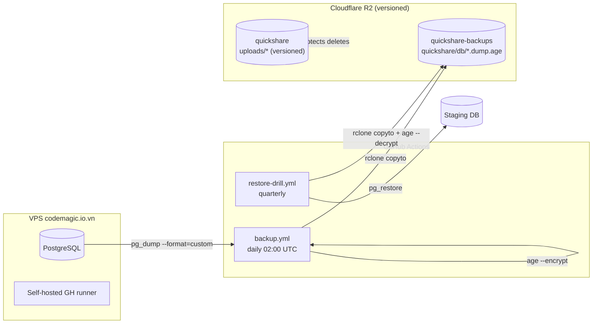

# Backup & Restore Runbook — PostgreSQL + Cloudflare R2

> Data safety for a file-storage product. A bad migration or R2 mistake must
> never mean permanent user-file loss. This runbook covers the **automated
> daily DB backup**, **R2 versioning**, and the **restore + quarterly drill**
> procedures. Ties #58 (restore is part of the trust story), #59 (account
> deletion needs correct R2 delete paths), #82 (no plaintext secrets anywhere).

---

## 1. What we protect, and how

| Asset | Where | Protection | Restore path |
|-------|-------|------------|--------------|
| **PostgreSQL** (users, deliveries, usage, payments) | VPS `codemagic.io.vn` | Daily `pg_dump` → `age`-encrypted → R2 private bucket, 30-day retention | `ops/backup/restore.sh` |
| **R2 delivery objects** (`uploads/*`, `avatars/*`) | Cloudflare R2 | **Object versioning** on the bucket | R2 version restore (per object) |
| **Backup secrets** | GitHub Actions secrets | `age` public key on the box; private key offline | — |

**Threat model:** the backup must survive (a) a bad EF migration, (b) an
accidental `DELETE` / overwrite on R2, (c) server loss. That is why dumps are
**encrypted at rest** (no plaintext dump ever exists) and R2 is **versioned**
(deletes are soft).

---

## 2. Architecture



Backup object naming: `quickshare/db/quickshare-<UTC-timestamp>.dump.age`
(e.g. `quickshare-20260815T020000Z.dump.age`). Names sort lexicographically =
chronologically, so "latest" is the last line of `rclone lsf`.

---

## 3. R2 bucket versioning (delete protection)

R2 versioning must be ON for **both** buckets. This is a one-time setup on the
Cloudflare dashboard (or via API), not code.

### 3.1 Delivery bucket (`R2_BUCKET_NAME`, e.g. `quickshare`)

1. Cloudflare dashboard → **R2** → select the bucket → **Settings**.
2. Toggle **Object versioning** → **On**.
3. Confirm. Deletes now create a delete marker instead of destroying data.

### 3.2 Backup bucket (`BACKUP_R2_BUCKET`, e.g. `quickshare-backups`)

1. Create a **new** bucket (private — do **not** enable public access).
2. Enable **Object versioning** the same way.
3. Create an API token scoped to **this bucket only** (Object Read + Write):
   Cloudflare → R2 → **Manage R2 API Tokens** → Create → scope to the bucket.
   Record `AccountId`, `AccessKeyId`, `AccessKeySecret`.

> **Why a separate bucket:** the app's R2 token and the backup token have
> different blast radii. A leaked backup token must not be able to list/delete
> user uploads, and vice versa.

---

## 4. Encryption (age)

`age` (`age-encryption.org`) is used because it is dead-simple and has no
key-management ceremony. **Plaintext dumps never touch disk** — `pg_dump`
streams into `age` via a pipe (`backup.sh` step 1).

### 4.1 Generate the keypair (once, on a trusted machine)

```bash
age-keygen -o quickshare-backup.key.txt   # prints: # created: ... / # public key: age1...
```

- **Public key** (`age1...`) → GitHub secret `BACKUP_AGE_PUBLIC_KEY`.
- **Private key** (the whole `quickshare-backup.key.txt`) → GitHub secret
  `BACKUP_AGE_PRIVATE_KEY`, **and** a copy in your password manager / offline
  storage. It is the *only* way to decrypt a backup. Lose it = lose the backups.

> gpg alternative: if you already run gpg, `gpg --encrypt --recipient <key>` and
> `gpg --decrypt` are drop-in replacements for the two `age` calls in the
> scripts — the pipe/stream structure is identical.

---

## 5. Backup (automated, daily)

### 5.1 Via GitHub Actions (default)

`.github/workflows/backup.yml` runs daily at 02:00 UTC (and on
`workflow_dispatch`). It builds the tiny `ops/backup` image on the self-hosted
runner and runs `backup.sh` inside it — the runner is on the same network as
PostgreSQL, so the DB is reachable.

Failure = failed workflow run = GitHub notifies the repo owner. No extra
alerting needed.

### 5.2 Alternative: cron on the VPS (no GitHub Actions)

Where PostgreSQL itself lives (Linux):

```bash
# install deps once
apt-get install -y postgresql-client rclone age
mkdir -p /opt/quickshare-backup && cp ops/backup/backup.sh /opt/quickshare-backup/

# /etc/cron.d/quickshare-backup  (daily 02:00, as root)
0 2 * * * root /opt/quickshare-backup/backup.sh >> /var/log/quickshare-backup.log 2>&1
```

Env vars (`DB_CONNECTION_STRING`, `BACKUP_*`) live in `/etc/default/quickshare-backup`
or the cron entry itself. **Never commit them.**

---

## 6. Restore

### 6.1 PostgreSQL restore (to staging or prod)

```bash
# into a fresh/empty staging DB
export RESTORE_DB_CONNECTION_STRING="Host=staging...;Database=quickshare;..."
export BACKUP_AGE_PRIVATE_KEY="$(cat quickshare-backup.key.txt)"
export BACKUP_R2_ACCOUNT_ID=... BACKUP_R2_ACCESS_KEY_ID=... BACKUP_R2_ACCESS_KEY_SECRET=... BACKUP_R2_BUCKET=...

# restore latest
./ops/backup/restore.sh

# restore a specific dump (override)
BACKUP_FILE=quickshare-20260815T020000Z.dump.age ./ops/backup/restore.sh
```

`restore.sh` downloads → decrypts → `pg_restore --clean --if-exists --no-owner
--no-privileges` into the target DB, then (if `RESTORE_VERIFY_QUERY` is set)
runs a smoke query that must return rows.

> `pg_dump -Fc` (custom format) + `pg_restore` lets you restore selective
> objects if needed: `pg_restore --list dump | grep ...` then
> `pg_restore --use-list=...`.

### 6.2 R2 object restore (a deleted/overwritten file)

With versioning on, a deleted object leaves a delete marker; restore by copying
the previous version:

```bash
# List versions of an object
aws s3api list-object-versions --bucket "$R2_BUCKET_NAME" --prefix "uploads/<user>/<delivery>/<name>" \
  --endpoint-url "https://$R2_ACCOUNT_ID.r2.cloudflarestorage.com"

# Copy a specific (previous) version back to the live key
aws s3api copy-object \
  --bucket "$R2_BUCKET_NAME" \
  --copy-source "$R2_BUCKET_NAME/uploads/<...>/<name>?versionId=<id>" \
  --key "uploads/<...>/<name>" \
  --endpoint-url "https://$R2_ACCOUNT_ID.r2.cloudflarestorage.com"
```

(R2 is S3-compatible; `aws` CLI with `--endpoint-url` works. `rclone` also
supports `--s3-version-at`.)

---

## 7. Quarterly restore drill

`.github/workflows/restore-drill.yml` runs on the 1st of Jan/Apr/Jul/Oct at
03:00 UTC, plus `workflow_dispatch`. It restores the **latest** backup into the
**staging** DB and gates on `SELECT count(*) FROM users` returning ≥ 1 row.

**This is the acceptance criterion for the backup system.** A backup that has
never been restored is a hope, not a backup. If the drill fails, fix it before
the next quarter — do not let it lapse.

To run now: GitHub → Actions → **Restore Drill** → **Run workflow**.

---

## 8. Retention

- **DB dumps:** `backup.sh` prunes objects older than `BACKUP_RETENTION_DAYS`
  (default **30 days**) via `rclone delete --min-age`. Older dumps also remain
  recoverable through R2 versioning until a lifecycle rule purges them.
- **Lifecycle rule (optional):** on the backup bucket, add an R2 lifecycle rule
  to permanently delete non-current versions after e.g. 90 days, so versioning
  does not grow unbounded.

---

## 9. GitHub Actions secrets

| Secret | Used by | Notes |
|--------|---------|-------|
| `BACKUP_DB_CONNECTION_STRING` | backup.yml | Prod PostgreSQL URI |
| `BACKUP_AGE_PUBLIC_KEY` | backup.yml | `age1...` recipient |
| `BACKUP_AGE_PRIVATE_KEY` | restore-drill.yml | Full `age-keygen` output |
| `BACKUP_R2_ACCOUNT_ID` | both | R2 account id |
| `BACKUP_R2_ACCESS_KEY_ID` | both | Token scoped to backup bucket |
| `BACKUP_R2_ACCESS_KEY_SECRET` | both | Token secret |
| `BACKUP_R2_BUCKET` | both | `quickshare-backups` |
| `BACKUP_RETENTION_DAYS` | backup.yml (optional) | Default `30` |
| `STAGING_DB_CONNECTION_STRING` | restore-drill.yml | Staging DB to restore into |

Set these in GitHub → repo → Settings → Secrets and variables → Actions.

---

## 10. Verification checklist

```bash
# 1. Backup image builds
docker build -t quickshare-backup ops/backup

# 2. Manual backup run (from a host with DB + R2 access)
docker run --rm -e DB_CONNECTION_STRING -e BACKUP_AGE_PUBLIC_KEY \
  -e BACKUP_R2_ACCOUNT_ID -e BACKUP_R2_ACCESS_KEY_ID \
  -e BACKUP_R2_ACCESS_KEY_SECRET -e BACKUP_R2_BUCKET \
  quickshare-backup backup

# 3. Backup landed in R2
rclone lsf "backup:$BACKUP_R2_BUCKET/quickshare/db" --files-only

# 4. R2 versioning is on (both buckets)
#    Cloudflare dashboard → R2 → bucket → Settings → Object versioning = On

# 5. Restore drill passes
#    GitHub → Actions → Restore Drill → Run workflow → green + "Verification OK"
```

---

## 11. Recovery quick reference

| Symptom | Action |
|---------|--------|
| Bad migration corrupted schema | Restore latest dump into staging, diff schema, replay to prod |
| Accidental R2 delete / overwrite | Restore previous object version (§6.2) |
| Server lost / total DB loss | Provision fresh Postgres, `restore.sh` latest dump, re-point app |
| Drill failing | Read drill run logs; check `BACKUP_AGE_PRIVATE_KEY` + staging reachability |
