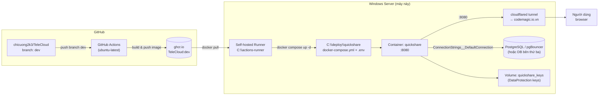
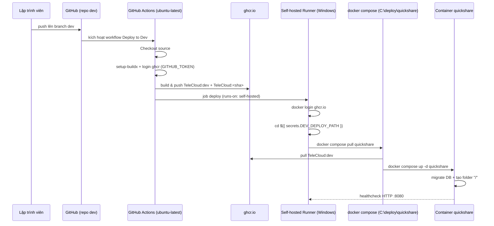

# Deployment Diagram — Dev (self-hosted runner)

Sơ đồ luồng CI/CD từ GitHub Actions đến Windows Server, deploy container `quickshare`
lên Docker bằng self-hosted runner.

## Sơ đồ tổng quan



## Luồng CI/CD



## Thành phần chính

| Thành phần | Vị trí / Giá trị | Ghi chú |
|-----------|------------------|---------|
| Workflow | `.github/workflows/deploy-dev.yml` | Trigger: push branch `dev` hoặc `workflow_dispatch` |
| Image | `ghcr.io/chicuong2k3/TeleCloud:dev` | Cũng tag thêm `:<commit-sha>` |
| Runner | `C:\actions-runner`, repo `chicuong2k3/TeleCloud` | Đăng ký vào pool `Default`, `runs-on: self-hosted` |
| Deploy path | `C:\deploy\quickshare` | Secret `DEV_DEPLOY_PATH` trỏ tới thư mục này |
| Compose | `C:\deploy\quickshare\docker-compose.yml` | Service `quickshare`, bind `127.0.0.1:8080` |
| Env vars | `C:\deploy\quickshare\.env` | Được compose đọc, truyền vào container dạng `__` |
| Container port | `8080` (internal) | `ASPNETCORE_URLS=http://+:8080`, non-root `appuser` |
| Key volume | `quickshare_keys:/app/keys` | DataProtection keys, giữ auth cookie ổn định |
| Public URL | `https://codemagic.io.vn` | Cloudflare tunnel (host) → `http://localhost:8080` |
| Database | `DB_CONNECTION_STRING` trong `.env` | PostgreSQL (có thể chạy host hoặc bên thứ ba) |

## Flow env var → app config

```
.env trên server
   │  (docker compose đọc ${VAR})
   ▼
docker-compose.yml  environment:
   ConnectionStrings__DefaultConnection=${DB_CONNECTION_STRING}
   Authentication__Google__ClientId=${GOOGLE_CLIENT_ID}
   R2__AccountId=${R2_ACCOUNT_ID}
   PayOS__ClientId=${PAYOS_CLIENT_ID}
   │
   ▼
Container env var  →  IConfiguration (appsettings.json + env var override)
```

## Lệnh deploy thủ công (test)

```powershell
cd C:\deploy\quickshare
docker compose pull quickshare
docker compose up -d --remove-orphans quickshare
docker compose logs -f quickshare
```

## Lưu ý

- Thiếu `DB_CONNECTION_STRING` → app crash ngay lúc khởi động.
- Sai Google OAuth → login không hoạt động (các OAuth khác optional).
- R2 không cấu hình → app fallback local disk, upload qua R2 sẽ lỗi.
- Cloudflare tunnel chạy trên host, route `http://localhost:8080` (quickshare bind loopback, không lộ ra ngoài).
