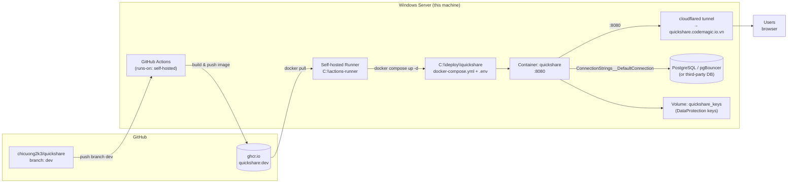
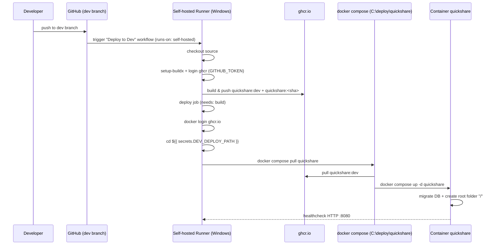

# Deployment Diagram — Dev (self-hosted runner)

CI/CD flow from GitHub Actions to a Windows Server, deploying the `quickshare`
container to Docker using a self-hosted runner.

## Overview



## CI/CD flow



## Components

| Component | Location / Value | Notes |
|-----------|------------------|-------|
| Workflow | `.github/workflows/deploy-dev.yml` | Triggers on push to `dev` branch or `workflow_dispatch` |
| Image | `ghcr.io/chicuong2k3/quickshare:dev` | Lowercase (ghcr requirement); also tagged `:<commit-sha>` |
| Runner | `C:\actions-runner`, repo `chicuong2k3/quickshare` | Registered to `Default` pool; both `build` and `deploy` jobs run on `self-hosted` |
| Deploy path | `C:\deploy\quickshare` | Secret `DEV_DEPLOY_PATH` points to this folder |
| Compose | `C:\deploy\quickshare\docker-compose.yml` | Service `quickshare`, binds `127.0.0.1:8080` |
| Env vars | `C:\deploy\quickshare\.env` | Read by compose, passed into the container as `__`-separated keys |
| Container port | `8080` (internal) | `ASPNETCORE_URLS=http://+:8080`, non-root `appuser` |
| Network | `cfnet` (external, shared with cloudflared) | Tunnel routes `http://quickshare:8080` |
| Key volume | `quickshare_keys:/app/keys` | DataProtection keys, keeps auth cookies stable |
| Public URL | `https://quickshare.codemagic.io.vn` | Cloudflare tunnel (host) → `http://quickshare:8080` (cfnet network) |
| Database | `DB_CONNECTION_STRING` in `.env` | PostgreSQL (host or third-party) |

## Env var → app config flow

```
.env on the server
   │  (docker compose reads ${VAR})
   ▼
docker-compose.yml  environment:
   ConnectionStrings__DefaultConnection=${DB_CONNECTION_STRING}
   Authentication__Google__ClientId=${GOOGLE_CLIENT_ID}
   R2__AccountId=${R2_ACCOUNT_ID}
   PayOS__ClientId=${PAYOS_CLIENT_ID}
   │
   ▼
Container env var  →  IConfiguration (appsettings.json + env var override)
```

## Manual deploy (test)

```powershell
cd C:\deploy\quickshare
docker compose pull quickshare
docker compose up -d --remove-orphans quickshare
docker compose logs -f quickshare
```

## Verify workflow run

- GitHub Actions tab → latest run → `build` + `deploy` jobs
- On the server, a running job spawns `Runner.Worker`; logs at `C:\actions-runner\_diag\Worker_*.log`
- Runner status: repo → Settings → Actions → Runners

## Notes

- Missing `DB_CONNECTION_STRING` → app crashes at startup.
- Wrong Google OAuth → login does not work (other OAuth providers are optional).
- R2 not configured → app falls back to local disk; uploads via R2 will fail.
- Cloudflare tunnel runs in the `cfnet` network, routes `http://quickshare:8080` (quickshare is on the same `cfnet` network, so no host port is exposed publicly; `127.0.0.1:8080` binding is only for local host access).
