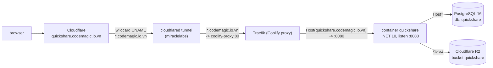

# Deployment — Coolify

Production runs on the **Coolify instance at `https://coolify.codemagic.io.vn`**, on the Coolify host
machine (the same box that runs the `cloudflared` tunnel). Coolify builds this repo's `Dockerfile`
from `master`; there is no image registry, no compose file and no GitHub Actions deploy job.

## Topology



The app **must** live on the Coolify host machine: the tunnel's wildcard rule terminates at that
machine's Traefik. An app deployed to a different Coolify server has no router there and answers
Traefik's 19-byte `404 page not found` however healthy its container is.

## Coolify resource IDs

| Resource | UUID / value |
|---|---|
| Project | `0pq1pzexeg8jbguglwz6gves` (QuickShare) |
| Environment | `pcu80hojvkz8oddsspgebqp4` (`production`) |
| Application | `l4wrthznhxtp5ghfzazgvgcs` (`quickshare`) |
| Database | `prsxwkbesydshnizbzq1rzd3` (`quickshare-db`, db `quickshare`) |
| S3 storage (backups) | `lapupl2a1aeshdwtdko43x1s` (`quickshare-r2`) |
| Backup schedule | `wt1ylc7yjmunbqx4zmf3xodn` — `0 2 * * *`, save to S3, `dump_all` |
| Destination | `tr6azcmyt92oitrczgeudao6` (localhost, `coolify` network) |
| Public URL | `https://quickshare.codemagic.io.vn` |
| Container port | `8080` (`ASPNETCORE_URLS=http://+:8080`) |

App settings: build pack `dockerfile`, dockerfile location `/Dockerfile`, `ports_exposes=8080`,
memory limit `1024m`, domain `http://quickshare.codemagic.io.vn` (http on purpose — cloudflared
speaks plain HTTP to Traefik; Cloudflare terminates TLS).

## Deploy

Pushes to `master` deploy automatically through the Coolify GitHub webhook
(`https://coolify.codemagic.io.vn/webhooks/source/github/events/manual`, secret in the app settings).
Manual:

```bash
API=https://coolify.codemagic.io.vn/api/v1
APP=l4wrthznhxtp5ghfzazgvgcs
curl -X POST -H "Authorization: Bearer $COOLIFY_TOKEN" "$API/deploy?uuid=$APP"     # build + deploy
curl -X POST -H "Authorization: Bearer $COOLIFY_TOKEN" "$API/applications/$APP/restart"  # restart only
curl -s  -H "Authorization: Bearer $COOLIFY_TOKEN" "$API/deployments/$DEPLOY_UUID"      # watch it
```

## Environment variables

Set on the app in Coolify (runtime + buildtime). No `.env` in the repo.

| Key | Notes |
|---|---|
| `ASPNETCORE_ENVIRONMENT` | `Production` |
| `ConnectionStrings__DefaultConnection` | `Host=<db container uuid>;Port=5432;Database=quickshare;Username=postgres;Password=…` |
| `DataProtection__KeyPath` | `/app/keys` |
| `R2__AccountId`, `R2__BucketName`, `R2__AccessKeyId`, `R2__AccessKeySecret` | legacy `R2` section — `ObjectStoreResolver` still binds it; `ObjectStore__*` is the current shape |
| `Authentication__Google__ClientId`, `…ClientSecret` | redirect URI `https://quickshare.codemagic.io.vn/signin-google` |
| `PayOS__ClientId`, `PayOS__ApiKey`, `PayOS__ChecksumKey` | placeholders → boot logs `PayOS:WebhookUrl not configured` |

On boot the app runs pending EF migrations, then `EnsureBucketExistsAsync()` (HeadBucket) on the
object store.

## Health

`GET /health` → `200` only when every check passes:

- `postgresql` — `SELECT 1;`
- `email` — email config sanity (`EmailConfigHealthCheck`)
- `r2` — authenticated `HeadBucket` (`R2HealthCheck`); never a bucket-root GET, which R2 rejects with 400

`/health` is mapped before the auth pipeline, so it stays reachable from probes.

## Backups

Coolify dumps `quickshare` daily at 02:00 UTC into the R2 bucket `quickshare` through the
`quickshare-r2` S3 storage. Verify or dump on demand:

```bash
curl -s -H "Authorization: Bearer $COOLIFY_TOKEN" "$API/databases/prsxwkbesydshnizbzq1rzd3/backups"
```

The old GitHub `backup.yml` runner workflow pointed at the pre-Coolify database host and cannot reach
the current one (it lives inside the Coolify host's Docker network, no public port).

## DNS / ingress

Zone `codemagic.io.vn` has one proxied wildcard `CNAME *.codemagic.io.vn -> 812e074f-….cfargotunnel.com`
(tunnel `miraclelabs`), whose config routes `*.codemagic.io.vn` to `http://coolify-proxy:80`.
`quickshare` needs **no explicit DNS record**. Cloudflare SSL mode `full`.

Proxy fingerprint when something is wrong:

| Response | Meaning |
|---|---|
| `404 page not found` (19 bytes, text/plain) | Traefik instance without a router for that host → app is not on the Coolify host |
| `503 no available server` (20 bytes) | Traefik has the router but no healthy backend → container down |
| Cloudflare `502` / `error code: 502` | Cloudflare could not reach the origin/tunnel |

## Rollback

Coolify UI → app → Deployments → pick the previous successful deployment → Redeploy. Or revert the
commit on `master` and let the webhook deploy.

DataProtection keys live at `/app/keys` inside the container filesystem; the path is not a registered
persistent volume, so a rebuild invalidates existing auth cookies and users log in again.
